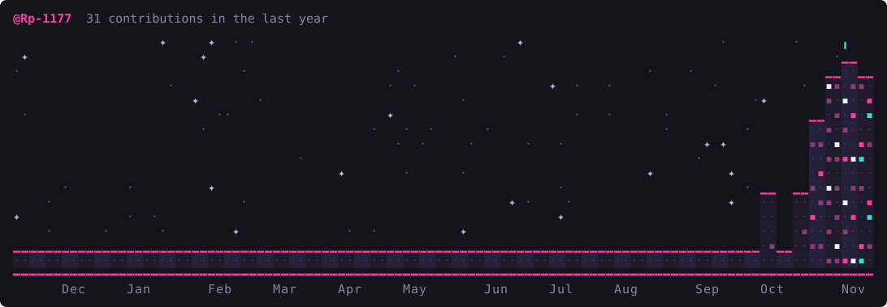

<div allign="center">

# 👾 RUAN PABLO

### 'FULL STACK DEVELOPER IN PROGRESS'


<br/>

[](https://github.com/Rp-1177)

</div>

---

## 🎮 PLAYER PROFILE

```text
PLAYER: RUAN PABLO
CLASS: FULL STACK DEVELOPER
CURRENT QUEST: Building real-worlds projects
SPECIALIZATION: Backend / Frontend / Database
STATUS: Always learning...
```

## 🧠 ABOUT ME

- 💻 Desenvolvedor em constante evolução.
- 🎓 Graduado em Análise e Desenvolvimento de Sistemas.
- 🚀 Desenvolvendo projetos Full Stack e aplicações web.
- 🗄️ Aprofundando estudos em APIs REST, TypeScript e Docker.
- 🎯 Buscando transformar objetivos em realidade através da tecnologia.

## ⚔️ TECH ARSENAL

<div align="center">


</div>

## 📊 PLAYER STATISTICS

<div align="center">


</div>

## 🏙️ MY CONTRIBUTION CITY

<div align="center">



</div>

## 🐍 CONTRIBUTION SNAKE

<div align="center">

 

</div>

## 🚀 FEATURED PROJECTS

<div align="center">

<a href="https://github.com/Rp-1177/portfolio-rp">
    
</a>

<a href="https://github.com/Rp-1177/To-Do-API">
    
</a>

<a href="https://github.com/Rp-1177/projeto_full-stack">
    
</a>

</div>

---

<div align="center">

### `GAME OVER? NEVER. KEEP BUILDING.`

⭐ Thanks for visiting my profile!

</div>


